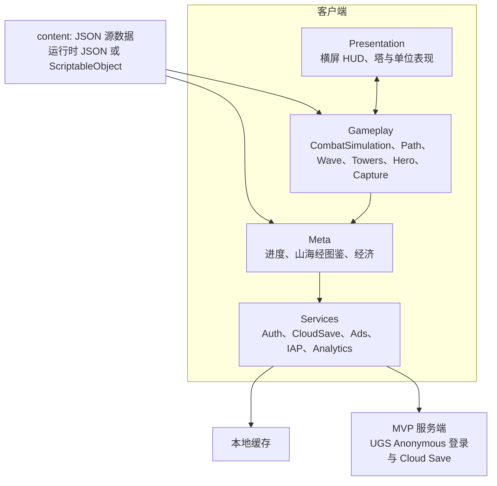
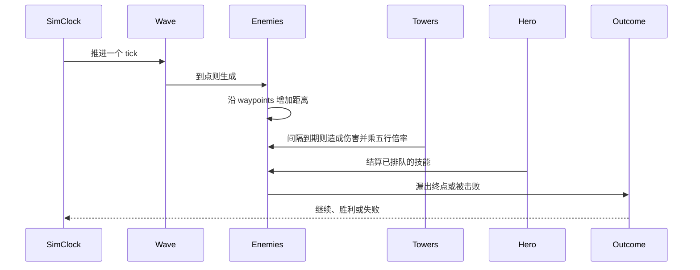

# 架构草案

状态：与 [TECH_STACK.md](TECH_STACK.md) 一起处于预制作。分层、模拟方式和 schema 字段名按此实现；平衡数值、文案和美术不在这里。

引擎已于 2026-11-08 锁定为 Unity 6 LTS + URP 2D Renderer + C#。v1 平台为 iOS 与 Android，首发发行范围是海外 / 非大陆，不含中国大陆渠道。云后端锁定为 Unity Gaming Services（Authentication + Cloud Save）。MVP 登录锁定为 UGS Anonymous / Guest（设备）→ Cloud Save。程序集、ScriptableObject 与 Addressables 按此落点。见 [TECH_STACK.md](TECH_STACK.md)。

## 总览

客户端分成四层。对局内的真相在 Gameplay 的 tick 模拟里。表现层只显示快照和收集操作。局外进度在 Meta。登录、云存档、广告、支付和分析都走 Services。玩法代码不直接调用 SDK。

战斗循环、路径、波次、塔、英雄和捕获的划分保持不变。iOS 与 Android 的登录和支付差异收在 Services 里。



依赖规则：

- Presentation 读取模拟快照，提交意图：放置塔、施放技能、暂停、切换倍速。它不修改生命值。
- Gameplay 读取内容与意图，按 tick 写下战斗状态。Gameplay 不引用 Auth、CloudSave、广告或支付 SDK。
- Meta 管一局之外的事：进入关卡、收下胜负结果、写进度与图鉴。进度经 CloudSave 提交。对局进行中，Meta 不改模拟内部状态；暂停和退出走明确接口。
- Services 是 IO。Auth 与 CloudSave 的具体 SDK 藏在各自实现里，玩法层只看见接口。
- 捕获在对局内产生「解锁意图」，由 Meta 经 CloudSave 写入账号档案。模拟本身不写玩家档案。

## 客户端分层

### Presentation

横屏。战斗参考 1920×1080：HUD 安全区为顶部约 120px、底部约 100px、左右各约 120px，按钮和说明放在这里，路径与建造格避开。战场逻辑是 16×9 世界单位，正交相机 size 4.5，`ToWorld(x,y)=((x−0.889)×9,(y−0.5)×9)` 不变。

### 战斗背景

1920×1080 是安全区。战斗背景按这张画布、Pixels Per Unit **120** 导入，正好 16×9 world。像素（左上原点，py 向下）到 world：

`wx = (px − 960) / 120`

`wy = (540 − py) / 120`

Pivot 在中心，正图 Transform Position (0, 0)、Scale 1。不要用 Scale 0.8333，也不要改逻辑坐标。

以后正式背景可以按 **2340×1440** 整张交付，中间 1920×1080 是安全区。当前冀州 01 正图仍是 1920×1080，像素不改。PPU 120 下正图正好盖住 16×9。19.5:9、正交 size 4.5 时左右各多出 1.75 world；4:3 若把正交 size 放到 6，上下各多出 1.5 world。这两块由正图下面的出血 sprite 盖住：`bg_jizhou01_battle_bleed`，2340×1440，PPU 120，Scale 1，中心 (0, 0)，覆盖 **19.5×12** world，Default 层 Order -110。正图 Order -100。

出血图不是把缩略图放大。`tools/generate_jizhou01_bleed.py` 把正图原样贴在中间 1920×1080，外圈用很窄的边缘条做镜像拉伸，再按离开安全区的距离由内向外加重模糊，并稍微压暗、降饱和。接缝外侧的第一圈像素等于正图边缘。相机清屏色仍是草场 `#9DB22A`，只在出血图之外露出来。

正图导入：Sprite (2D and UI)、Single、Filter Bilinear、关 Mipmap、Max Size 2048、Wrap Clamp、Alpha Is Transparency 关。出血图相同，但 Max Size 是 **4096**，避免 2340 被缩到 2048。iOS（`iPhone`）与 Android 的平台覆盖都是 ASTC 6×6（`textureFormat: 50`），写在纹理 `.meta` 里。没有单独的 Background 排序层。

### 冀州 01 单位图

首批单位用 `v2/master_2x` 母版，放在 `Assets/Game/Resources/BattleArt/`。美术 spec 按 1280×720、PPU 100 制作，2× 母版名义 PPU 200。本工程战场高是 9 world（1080 px @ PPU 120）。要保持占屏幕高度的比例，2× 母版应对 **PPU 160**（1× 则是 PPU 80）：720/100 = 7.2，9/7.2 = 1.25，200/1.25 = 160。和背景里已经画死的石台、鼎台、路宽对不齐的，改用下表的 PPU。

| 资产 | 像素 | PPU | 画布 world | 对位 |
| --- | --- | --- | --- | --- |
| 剑阵塔身 `tower_jin_body` | 192×192 | 160 | 1.20×1.20 | 最宽处距中心 76 px → 半宽 0.475 world，小于最近格心到路缘约 0.55。脚底在格心下方 0.03 world。Pivot (0.5, 0.021) |
| 剑阵特效 `tower_jin_fx` | 4×192×192 | 160 | 每帧 1.20×1.20 | 12 fps 单次，约 0.33 s。Pivot 中心。材质 `SpriteAdditive`（SrcAlpha One） |
| 当康行走 | 8×128×128 | 160 | 0.80×0.80 | 10 fps 循环。躯干宽约 85–100 px → 0.53–0.63 world（约 64–75 px@1080）。路宽均值约 73 px@1080 ≈ 0.61 world。朝右，向左走时 flipX。Pivot (0.5, 0.031) |
| 当康受击白/红、死亡 | 各 128×128 | 160 | 0.80×0.80 | 受击先闪白 0.05 s 再闪红 0.05 s。死亡停留 0.4 s 后用约 0.4 s 淡出。漏到终点不播死亡 |
| 铜鼎 `ding_bronze` | 256×256 | 170 | 1.51×1.51 | 石座宽 210 px → 1.235 world ≈ 148 px@1080，对齐背景鼎台外径。底部锚点在 ding (1.53, 0.23)。Pivot (0.5, 0.016) |
| 建造格三态 | 3×128×128 | 200 | 每帧 0.64×0.64 | 不透明石台宽 116 px → 0.58 world ≈ 70 px@1080，略大于背景石台 64 px（0.533 world）。中心压在格坐标上。Pivot 中心 |
| HUD 灵石 / 心 / 波次 | 各 128×128 | 160 | 不进世界 | IMGUI 参考边长 42 px@1080。PPU 只写在导入设置里 |

建造格：空着且买得起时是普通；光标所在或已排队时是选中；买不起是禁用；已经建成则藏掉格子，由塔身石座盖住。

排序都在 Default 层：出血 -110，正图 -100，路径调试线 10，建造格 30，塔 / 当康 / 铜鼎按脚底 world y 从 1000 起减（y 越大越靠后），攻击特效 3000。

换帧按模拟时间 ` (tick + 插值) × 0.1 `。行走帧号是沿路径距离 / speed，再乘 `10 fps × 0.1 s`。攻击特效在表现层按 `attackIntervalTicks` 自己计时，只读快照里的位置和血量。这些都不写回 `CombatSimulation`，也不改 `SimClock`。

冀州 01 的图是 `bg_jizhou01_battle`，与 `path_jizhou_01` 绑定，改航点必须同步改图。入口外的土路只是画面，敌人从航点 0 开始走，不另加航点。

M1 只需要开战、胜、负、倍速桩。M2 起 HUD 四角放五行与资源占位，具体锚点跟着 UI 壳走。M6 的局外枢纽是另一套横屏界面，不塞进战斗 HUD。

表现在两个模拟 tick 之间插值单位位置。暂停时模拟时钟停止，界面仍可点「继续」。

### Gameplay

| 模块 | 职责 |
| --- | --- |
| CombatSimulation | 固定 tick 的权威循环、胜负、倍速 |
| Path | 折线路径点，敌人用沿路径距离移动 |
| Wave | 按关卡数据刷怪 |
| Towers | 放置、索敌、攻击间隔、以后的合成 |
| Hero | 可操控英雄。M3 之前可以是空实现 |
| Capture | 捕获判定，产出图鉴解锁意图 |

M1 实现 Path、Wave、Towers（仅 `tower_jin`）、CombatSimulation。Hero 与 Capture 留接口。

### Meta

- 进度：已到达的关卡 id，胜负记录的形状见存档一节。
- 山海经图鉴：异兽 id 是否解锁。M5 只做一页桩。
- 经济：货币 id 与数量。货币种类和定价由策划表填，程序用字符串 id，不在代码里写死展示名。

### Services

| 服务 | MVP | 以后 |
| --- | --- | --- |
| Auth | **LOCKED。** UGS Anonymous / Guest（设备）登录，得到稳定的账号 id，再交给 Cloud Save。首发系统是海外 / 非大陆的 iOS 与 Android。接口是 `IAuthService`，不暴露供应商 SDK。默认实现走游客路径 | Apple / Google Sign-In 与账号绑定（link）、注销。**POST-MVP / M2+，不进 M1 验收** |
| CloudSave | **LOCKED。** UGS Cloud Save。按游客账号读写进度。服务端副本是进度来源。接口是 `ICloudSaveService`。PlayFab 仅为应急，MVP 不并行实现 | IAP 权益与档案放在一起校验 |
| 本地缓存 | CloudSave 使用的缓存，放在 `Application.persistentDataPath`。缓存不是进度来源 | 断线策略以 spike 结论为准 |
| Ads | 接口空着 | 激励视频 |
| IAP | 接口空着 | Unity IAP；票据到服务端。首发不接国内渠道支付 |
| Analytics | 接口空着 | `level_start`、`level_end`、`tower_place` 等事件名以后再定稿 |

Auth 对外只暴露登录、登出和当前账号 id。令牌留在服务内部。MVP 的登录就是游客 / 设备登录，不要求 Apple 或 Google。CloudSave 对外只暴露按账号加载和保存档案。Meta 是二者的唯一玩法侧调用方。

供应商已锁定为 Unity Gaming Services（Authentication + Cloud Save），见 [TECH_STACK.md](TECH_STACK.md)。PlayFab 仅为应急，MVP 不并行实现。Services 只把 `IAuthService` 与 `ICloudSaveService` 暴露给玩法层，不把 UGS 类型漏进 Gameplay 或 Meta。游客路径的实现是 `UgsAuthService` 与 `UgsCloudSaveService`。未配置 Project ID 时组合根改用 Dev/Fake。接入见 [UGS_SETUP.md](UGS_SETUP.md)。

首发发行范围已锁定为海外 / 非大陆 iOS + Android，**不含中国大陆渠道**。大陆 App Store 与国内安卓渠道为 phase 2+。本阶段不接国内渠道 SDK，大陆合规不作为 M0/M1 阻塞。

没有账号 id 时，不把本机缓存当成已保存的 MVP 进度。游客登录成功后才有可用于 Cloud Save 的账号 id。

### 微信小游戏（二期，方案 D）

微信小游戏已按方案 D 延后到二期，不是仍在比较的 A–D。v1 不实现微信导出，也不为此预留第二套客户端。战斗模拟和 Auth / CloudSave 接口保持 iOS 与 Android。二期启动时再加导出适配。

## 内容数据

源数据用 JSON，放在 `content/`，方便评审。Unity 落地后可以导入为 ScriptableObject，再按章节打 Addressables。M1 允许运行时直接读 JSON，不把 Addressables 当成切片的前置条件。

`schemaVersion` 从 0 开始。读档和读表时版本不认识就在开发构建里失败，并保留原文件。

五行 id（代码路径用拼音，界面用中文）：

| id | 显示 | 相克（克） | 相生（生） |
| --- | --- | --- | --- |
| `jin` | 金 | `mu` | `shui` |
| `mu` | 木 | `tu` | `huo` |
| `tu` | 土 | `shui` | `jin` |
| `shui` | 水 | `huo` | `mu` |
| `huo` | 火 | `jin` | `tu` |

相克作用在「塔的五行 → 敌人的五行」的伤害结算。相生作用在已放置塔的邻接。两张表是全局数据，不抄进每一座塔。倍率数字另表，当前为空：未配置的克制关系不得在代码里写私有常数。中性关系不额外改伤。

邻接范围（四向或八向）和加成落在伤害还是攻击间隔，仍是开放问题。schema 预留字段，M2 用数据填。

### 塔 `shdg.tower`

样例：[content/examples/tower_jin.json](../content/examples/tower_jin.json)

| 字段 | 说明 |
| --- | --- |
| `id` | 稳定 id，如 `tower_jin` |
| `displayName` | 展示名 |
| `element` | `jin` / `mu` / `shui` / `huo` / `tu` |
| `economy.buildCost` | 建造花费，数值待表 |
| `economy.upgradeCosts` | 升级花费列表，可空 |
| `combat.damage` | 基础伤害，待表 |
| `combat.range` | 射程，单位与关卡 `space` 相同。冀州 01 是高度单位，金塔为 0.28 |
| `combat.attackIntervalTicks` | 两次攻击之间的 tick 数 |
| `combat.targetPriority` | 提案枚举：`first_along_path`、`last_along_path`、`nearest`、`strongest`。M1 只实现 `first_along_path` |
| `merge.enabled` / `merge.tier` | 合成。M1–M2 关闭 |

### 敌人 `shdg.enemy`

样例：[content/examples/enemy_dangkang.json](../content/examples/enemy_dangkang.json)

| 字段 | 说明 |
| --- | --- |
| `id` | 如 `enemy_dangkang` |
| `element` | 五行 id，或 `null` 表示尚未指定。M1 不结算相克，M2 前必须填上 |
| `combat.maxHp` | 生命。冀州 01 当康为 60；该关第 8 波乘 1.1 后为 66 |
| `combat.speed` | 沿折线速度，单位与关卡 `space` 相同，每 tick 的路径距离。冀州 01 当康为 0.006 高度单位/tick |
| `combat.leakDamage` | 漏到底时对失败规则的计量，规则本身待定 |
| `reward` | `currencyId` + `amount`，货币 id 待定 |

### 关卡波次 `shdg.level.waves`

样例：[content/examples/level_jizhou_01_waves.json](../content/examples/level_jizhou_01_waves.json)

| 字段 | 说明 |
| --- | --- |
| `id` | 如 `level_jizhou_01` |
| `pathId` | 以后路径可拆成独立资产时的 id |
| `space` | 坐标系 id。冀州 01 使用 `height_units_16x9`：x ∈ [0, 1.778]（左→右），y ∈ [0, 1]（下→上），(0,0) 为左下。世界坐标 `ToWorld(x,y)=((x−0.889)×9,(y−0.5)×9)`。加载器按 `space` 做闭区间边界校验，越界拒绝整张表。旧 `normalized_playfield`（x、y ∈ [0, 1]）仍可加载，正式关已迁出 |
| `waypoints` | 有序折线 `{ id, x, y }`。敌人只沿折线移动，不用自由导航。坐标必须落在 `space` 边界内 |
| `waves[]` | M1 垂直切片为 3 波。每波含 `spawns[]`：`enemyId`、`count`、`intervalTicks` |
| `outcome.win` | M1：`all_waves_cleared` |
| `outcome.lose` | 规则 id。形状样例为 `leak_rule_tbd`。M1 可玩切片使用 `leak_count` |

样例里的坐标、数量、间隔为 `null`，只说明字段形状。M1 可玩数字写在 `content/towers/`、`content/enemies/`、`content/levels/`，不回写形状样例。

切片关卡 `content/levels/level_jizhou_01.json` 的失败规则是 `leak_count`：漏出终点的敌人数达到 `outcome.loseLeakCount` 即负。`leakDamage` 按每次漏出累加，交给这条规则记账，但不折成基地生命。`loseLeakCount` 在这张表里是 3。形状样例的 `leak_rule_tbd` 不能开打。可建造格 `buildCells` 也只写在这张切片表上。

清场口径：某一波已经全部刷出，并且该波每一只敌人都已结算（被击杀，或漏入终点），即视为这一波清场，发放 `waveClearBase + waveClearPerWaveIndex × (w−1)`（w 从 1 起）。漏入的敌人不发击杀奖励，但计入清场。胜负另算：全部波次都清场且场上没有敌人则胜；漏出次数达到 `loseLeakCount` 则负，不必等这一波清场。

`tools/m1-slice-check` 用 C# 实测锁定冀州 01 的 tick，容差 ±5%。漏怪数和终局灵石不作容差。当康 `maxHp` 为 60 时：无塔在第 3 次漏出判负（946 tick，余额 120）；单塔分别放在 `cell_jin_01`、`cell_jin_02`、`cell_jin_03` 也都在第 3 次漏出判负（1806 / 2135 / 1775 tick，余额 321 / 449 / 313）；两座按 01→02、三座按 01→02→03 在余额够造价时建造，均为 0 漏通关（1977 tick，余额 540 / 440）。放置意图在下一个 tick 才生效。

### 英雄 `shdg.hero`（M3，本 PR 不附样例文件）

`id`、`displayName`、`moveMode`（待定枚举）、`skills[]`（`id`、`cooldownTicks`、`effectId`）。哪吒是 M3 的桩角色，技能效果走数据，具体技能设计不在本文。

### 元素表 `shdg.element.chart`（M2 再入库）

记录相克倍率与相生邻接加成。字段：`attacker`、`defender`、`relation`（`overcome` / `neutral` / `overcome_by`）、`damageMultiplier`；邻接另列 `source`、`target`、`stat`、`amount`。本 PR 不写这份表，避免空倍率被当成已平衡。

## 战斗循环

权威模拟用固定 tick，表现用帧更新。这样暂停和 2 倍速只改模拟时钟，不改伤害公式。跨设备回放若成为需求，再把模拟里的浮点改成整数；M1 允许浮点，不承诺跨设备逐位一致。

逻辑 tick 锁定 10Hz：`SimClock.TickSeconds` 为 0.1 秒墙钟，行为保持「累计墙钟、满 0.1 秒出一个 tick」。2 倍速只让同一帧里的累计更快，从而多跑 tick；不缩短 `TickSeconds`，也不把倍速乘进伤害。渲染仍跟显示刷新。



每个 tick 的顺序：

1. 若已经胜或负，不再推进。
2. Wave 按表生成敌人。
3. 敌人沿折线增加 `distanceAlongPath`。越过终点记一次漏出，并按 `leakDamage` 交给失败规则。
4. 塔若攻击间隔到达，按 `targetPriority` 选一个敌人，伤害乘元素表倍率后扣生命。
5. 已刷完的波若每一只都已结算（击杀或漏入），按清场口径发波次奖励。
6. 英雄技能队列在本 tick 结算。M1 队列为空。
7. 全部波次都已清场且场上没有敌人则胜。失败规则 id 命中则负。

触控在 tick 之间进入意图队列，下一个 tick 才生效，避免倍速时输入和模拟各算各的。

放置：M1 是固定路径旁的可建造格。格子数据随第一条关卡补，不在本样例里编造格子坐标。相生在 M2 检查相邻塔的五行。合成（merge）晚于 M2，字段先留着，`enabled` 为 false。

## 存档（MVP）

MVP 的进度是登录后的云存档。档案带 `schemaVersion` 和账号 id。

```json
{
  "schema": "shdg.save",
  "schemaVersion": 0,
  "accountId": null,
  "currencies": {},
  "levelProgress": {},
  "shanhaijingUnlocks": [],
  "settings": {
    "simulationSpeed": 1
  }
}
```

- `accountId` 来自 Auth。MVP 来自 UGS Anonymous / Guest。样例里为 `null`，表示尚未登录，不是一个名为 local 的档案。
- CloudSave 以服务端副本为进度来源。
- 客户端可以把同一份 JSON 缓存在 `Application.persistentDataPath`，先写临时文件再替换。缓存用于减少请求和承受短暂断线，不能单独充当 MVP 进度。
- `levelProgress` 的值形状在 M1 再定，至少能表达某关卡 id 已胜利，并经 CloudSave 写回。
- `shanhaijingUnlocks` 是异兽 id 列表。M5 写入一条，同样走 CloudSave。
- 设置里的倍速只记住玩家偏好，默认 1。
- 两台设备同时写入时的冲突规则仍是 OPEN。临时的后写覆盖只记在 `UgsCloudSaveService` 注释里（不带 writeLock；服务端 updated_at 为 `Item.Modified`）。选定后再写回本文。
- IAP 权益以后走服务端。广告奖励若会改档案，必须经 Meta，再由 CloudSave 提交。
