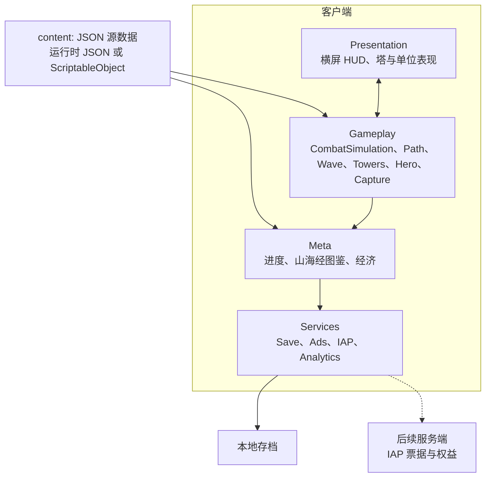
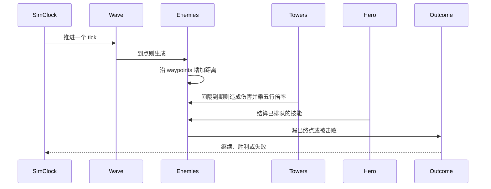

# 架构草案

状态：与 [TECH_STACK.md](TECH_STACK.md) 一起处于预制作。分层、模拟方式和 schema 字段名按此实现；平衡数值、文案和美术不在这里。

引擎暂定 Unity 6 LTS + C#。下文的程序集和 ScriptableObject 是 Unity 提案下的落点。若锁定为 Cocos 或 Godot，目录名可以换，层与层之间的依赖不换。

## 总览

客户端分成四层。对局内的真相在 Gameplay 的 tick 模拟里。表现层只显示快照和收集操作。局外进度在 Meta。广告、支付、分析和存档都走 Services，玩法代码不直接调用 SDK。



依赖规则：

- Presentation 读取模拟快照，提交意图：放置塔、施放技能、暂停、切换倍速。它不修改生命值。
- Gameplay 读取内容与意图，按 tick 写下战斗状态。
- Meta 管一局之外的事：进入关卡、收下胜负结果、写进度与图鉴。对局进行中，Meta 不改模拟内部状态；暂停和退出走明确接口。
- Services 是 IO。Gameplay 不引用广告或支付 SDK。
- 捕获在对局内产生「解锁意图」，由 Meta 写入存档。模拟本身不写玩家档案。

## 客户端分层

### Presentation

横屏。安全区与参考分辨率在工程创建时再定，本文不锁像素。

M1 只需要开战、胜、负、倍速桩。M2 起 HUD 四角放五行与资源占位，具体锚点跟着 UI 壳走。M6 的局外枢纽是另一套横屏界面，不塞进战斗 HUD。

表现在两个模拟 tick 之间插值单位位置。暂停时模拟时钟停止，界面仍可点「继续」。

### Gameplay

| 模块 | 职责 |
| --- | --- |
| CombatSimulation | 固定 tick 的权威循环、胜负、倍速 |
| Path | 折线路径点，敌人用沿路径距离移动 |
| Wave | 按关卡数据刷怪 |
| Towers | 放置、索敌、攻击间隔、以后的合成 |
| Hero | 可操控英雄。M3 之前可以是空实现 |
| Capture | 捕获判定，产出图鉴解锁意图 |

M1 实现 Path、Wave、Towers（仅 `tower_jin`）、CombatSimulation。Hero 与 Capture 留接口。

### Meta

- 进度：已到达的关卡 id，胜负记录的形状见存档一节。
- 山海经图鉴：异兽 id 是否解锁。M5 只做一页桩。
- 经济：货币 id 与数量。货币种类和定价由策划表填，程序用字符串 id，不在代码里写死展示名。

### Services

| 服务 | MVP | 以后 |
| --- | --- | --- |
| Save | 本地一份档案 | 云存档若产品要求再加 |
| Ads | 接口空着 | 激励视频 |
| IAP | 接口空着 | Unity IAP 或渠道支付；票据到服务端 |
| Analytics | 接口空着 | `level_start`、`level_end`、`tower_place` 等事件名以后再定稿 |

## 内容数据

源数据用 JSON，放在 `content/`，方便评审。Unity 落地后可以导入为 ScriptableObject，再按章节打 Addressables。M1 允许运行时直接读 JSON，不把 Addressables 当成切片的前置条件。

`schemaVersion` 从 0 开始。读档和读表时版本不认识就在开发构建里失败，并保留原文件。

五行 id（代码路径用拼音，界面用中文）：

| id | 显示 | 相克（克） | 相生（生） |
| --- | --- | --- | --- |
| `jin` | 金 | `mu` | `shui` |
| `mu` | 木 | `tu` | `huo` |
| `tu` | 土 | `shui` | `jin` |
| `shui` | 水 | `huo` | `mu` |
| `huo` | 火 | `jin` | `tu` |

相克作用在「塔的五行 → 敌人的五行」的伤害结算。相生作用在已放置塔的邻接。两张表是全局数据，不抄进每一座塔。倍率数字另表，当前为空：未配置的克制关系不得在代码里写私有常数。中性关系不额外改伤。

邻接范围（四向或八向）和加成落在伤害还是攻击间隔，仍是开放问题。schema 预留字段，M2 用数据填。

### 塔 `shdg.tower`

样例：[content/examples/tower_jin.json](../content/examples/tower_jin.json)

| 字段 | 说明 |
| --- | --- |
| `id` | 稳定 id，如 `tower_jin` |
| `displayName` | 展示名 |
| `element` | `jin` / `mu` / `shui` / `huo` / `tu` |
| `economy.buildCost` | 建造花费，数值待表 |
| `economy.upgradeCosts` | 升级花费列表，可空 |
| `combat.damage` | 基础伤害，待表 |
| `combat.range` | 射程，单位与坐标系一起定 |
| `combat.attackIntervalTicks` | 两次攻击之间的 tick 数 |
| `combat.targetPriority` | 提案枚举：`first_along_path`、`last_along_path`、`nearest`、`strongest`。M1 只实现 `first_along_path` |
| `merge.enabled` / `merge.tier` | 合成。M1–M2 关闭 |

### 敌人 `shdg.enemy`

样例：[content/examples/enemy_dangkang.json](../content/examples/enemy_dangkang.json)

| 字段 | 说明 |
| --- | --- |
| `id` | 如 `enemy_dangkang` |
| `element` | 五行 id，或 `null` 表示尚未指定。M1 不结算相克，M2 前必须填上 |
| `combat.maxHp` | 生命，待表 |
| `combat.speed` | 沿路径速度，单位待定（建议：每 tick 的路径距离） |
| `combat.leakDamage` | 漏到底时对失败规则的计量，规则本身待定 |
| `reward` | `currencyId` + `amount`，货币 id 待定 |

### 关卡波次 `shdg.level.waves`

样例：[content/examples/level_jizhou_01_waves.json](../content/examples/level_jizhou_01_waves.json)

| 字段 | 说明 |
| --- | --- |
| `id` | 如 `level_jizhou_01` |
| `pathId` | 以后路径可拆成独立资产时的 id |
| `space` | 坐标系 id。提案 `normalized_playfield`：相对可玩区域，原点与轴向在工程里定 |
| `waypoints` | 有序折线 `{ id, x, y }`。敌人只沿折线移动，不用自由导航 |
| `waves[]` | M1 垂直切片为 3 波。每波含 `spawns[]`：`enemyId`、`count`、`intervalTicks` |
| `outcome.win` | M1：`all_waves_cleared` |
| `outcome.lose` | 规则 id。样例为 `leak_rule_tbd`，等策划表指定漏怪如何失败 |

样例里的坐标、数量、间隔为 `null`，只说明字段形状。M1 补全第一条真实路径和三波数量后才可玩。

### 英雄 `shdg.hero`（M3，本 PR 不附样例文件）

`id`、`displayName`、`moveMode`（待定枚举）、`skills[]`（`id`、`cooldownTicks`、`effectId`）。哪吒是 M3 的桩角色，技能效果走数据，具体技能设计不在本文。

### 元素表 `shdg.element.chart`（M2 再入库）

记录相克倍率与相生邻接加成。字段：`attacker`、`defender`、`relation`（`overcome` / `neutral` / `overcome_by`）、`damageMultiplier`；邻接另列 `source`、`target`、`stat`、`amount`。本 PR 不写这份表，避免空倍率被当成已平衡。

## 战斗循环

权威模拟用固定 tick，表现用帧更新。这样暂停和 2 倍速只改模拟时钟，不改伤害公式。跨设备回放若成为需求，再把模拟里的浮点改成整数；M1 允许浮点，不承诺跨设备逐位一致。

tick 的墙钟长度不在本文锁定，垂直切片时测手感再记到技术笔记。M1 的 2 倍速是桩：模拟时钟相对 1 倍速按 2 倍推进，渲染仍跟显示刷新。实现可以「每帧多跑 tick」或「缩短 tick 间隔」，两选一即可。



每个 tick 的顺序：

1. 若已经胜或负，不再推进。
2. Wave 按表生成敌人。
3. 敌人沿折线增加 `distanceAlongPath`。越过终点记一次漏出，并按 `leakDamage` 交给失败规则。
4. 塔若攻击间隔到达，按 `targetPriority` 选一个敌人，伤害乘元素表倍率后扣生命。
5. 英雄技能队列在本 tick 结算。M1 队列为空。
6. 全部波次清空且场上无敌人则胜。失败规则 id 命中则负。

触控在 tick 之间进入意图队列，下一个 tick 才生效，避免倍速时输入和模拟各算各的。

放置：M1 是固定路径旁的可建造格。格子数据随第一条关卡补，不在本样例里编造格子坐标。相生在 M2 检查相邻塔的五行。合成（merge）晚于 M2，字段先留着，`enabled` 为 false。

## 存档（MVP）

先本地，后服务端。本地档案是一份带 `schemaVersion` 的 JSON。

```json
{
  "schema": "shdg.save",
  "schemaVersion": 0,
  "profileId": "local",
  "currencies": {},
  "levelProgress": {},
  "shanhaijingUnlocks": [],
  "settings": {
    "simulationSpeed": 1
  }
}
```

- 写入 `persistentDataPath`（或非 Unity 平台的等价私有目录），先写临时文件再替换，避免写到一半损坏。
- `levelProgress` 的值形状在 M1 再定，至少能表达某关卡 id 已胜利。
- `shanhaijingUnlocks` 是异兽 id 列表。M5 写入一条。
- 设置里的倍速只记住玩家偏好，默认 1。

MVP 没有账号服务器。服务端以后负责 IAP 收据校验和权益。权益一旦以上线为准，本地解锁标记变成缓存，冲突策略到接支付时再写，不在 M0 发明一套账号系统。

广告奖励若会改档案，必须经 Meta 的同一条写入路径，不能由广告回调直接改文件。
